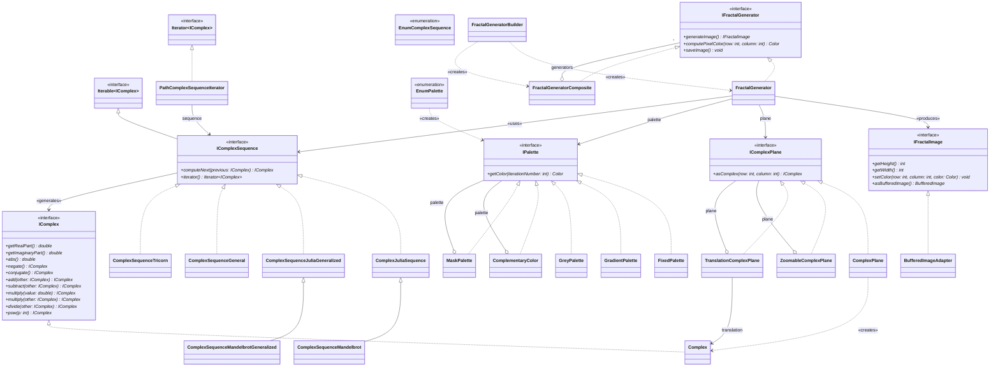

# FractaLens - A Fractal Generator Library Developed in Lens.

This project provides a *Java* library for generating fractal images.
It allows users to choose from a variety of complex sequences, including the
Julia set, Mandelbrot set, and other generalized sequences, to create
static or animated fractal images using different color palettes and
transformations.

## Overview

This library is composed of the following classes:


---
## How to use (CLI)

### Mandatory :
1.  **(-f/--fractal-name <name>)** : the name of the fractal to generate.
2.  **(-n/--nb-iterations <number>)** : the number of iterations to perform.
3.  **(-h/--height <pixels>)** : the height of the fractal image.
4.  **(-w/--width <pixels>)** : the width of the fractal image.
5.  **(-s/--scale <zoom>)** : the scale of the fractal.
6.  **(-x--focus-x <number>)** : the x-coordinate of the focus point (R).
7.  **(-y--focus-y <number>)** : the y-coordinate of the focus point (I).
8.  **(-p/--palette-name <name>)** : the name of the color palette to use.
9.  **(-t/--type <type>)** : the type of image to generate ("static" or "animated").
10. **(-i/--image-count <number>)** : the number of images to generate.
11. **(-o/--output-path <path>)** : the path where the image will be saved.
12. **(-a/--real <number>)** : the real part of the sequence point.
13. **(-b/--imaginary <number>)** : the imaginary part of the sequence point.
14. **(-z/--zoom <number>)** : the coefficient of zoom.
 
### Exemple : 
*static image* :
```bash
java -jar build/libs/fractalens-all.jar -f JULIA -n 250 -h 800 -w 800 -s 0.001 -x 0 -y 0 -p AURORA_PALETTE -t Unique -a 0.1 -b 0.6 -o fractal.png
```

*animated image* :
```bash
java -jar build/libs/fractalensMPCD-all.jar -f BURNING_SHIP -n 1000 -h 600 -w 600 -s 0.004 -x -1.543689012692076 -y 0 -p COSMIC_PALETTE -t Zoom -z 0.9 -i 166 -a 0 -b 0 -o burning_ship.gif
```
---
## Feature list

| Features                                               | Design Pattern(s) (?) | Author(s) |
|--------------------------------------------------------|-----------------------|-----------|
| Complex number                                         | none                  | DL        |
| Default complex plane                                  | none                  | PY        |
| Scaled complex plane                                   | decorator             | MN        |
| Translated complex plane                               | decorator             | DL        |
| Sequence of complex numbers                            | strategy              | CL        |
| Iterator over a sequence of complex numbers            | iterator              | MN        |
| Julia sequence                                         | strategy              | CL        |
| Mandelbrot sequence                                    | strategy              | PY        |
| Multijulia sequence                                    | strategy              | CL        |
| Multibrot sequence                                     | strategy              | PY        |
| Generic sequences                                      | strategy              | DL and MN |
| Color palette                                          | strategy              | CL        |
| Grey scale palette                                     | strategy              | CL        |
| Red/Green/Blue/... scale palette                       | decorator             | PY        |
| Inverted color palette                                 | decorator             | MN        |
| Gradient-based color palette                           | strategy              | CL        |
| Predefined color palette                               | strategy              | MN        |
| `BufferedImage` used as an `IFractalImage`             | adapter               | DL        |
| Static image generation                                | none                  | group     |
| Scale-based animated image generation                  | composite             | MN        |
| Rotation-based animated image generation               | composite             | PY        |
| Configuration of the fractal generator                 | builder               | DL        |
| Command-line interface                                 |                       |           |

## Team

This project has been developed by:

- Miont Nathan
- Coquerelle Lucille
- Pirmiet Youssef
- Deruelle Léo
